# 循智 EcoSort 算法优化实验报告

第8组；2026年10月26日。

# 一 实验目的

本实验围绕循智EcoSort多目标垃圾检测项目，承接实验一构建的数据集和实验二训练的YOLO11n模型，完成算法优化任务中的推理加速方向。实验一已统一图像尺寸、十类标签和分组划分；实验二已依据验证集确定A组全量微调模型为主模型。本实验以该模型的最佳权重为起点，研究在保持检测任务和权重来源一致的条件下，使用ONNX转换与TensorRT FP16引擎能否降低推理延迟。

本次选择任务3.1.4，重点是模型格式转换、推理引擎配置、Python端到端接口和效果验证。阶段二异构部署以及各处选做拓展不纳入本轮范围；不重新训练教师或学生模型，不开展INT8校准、结构剪枝或对抗训练。这样可以将实验问题限定为同一检测模型在不同执行后端下的精度与速度取舍，减少训练预算变化带来的干扰。

具体目标包括：掌握从PyTorch检测权重到ONNX计算图、再到TensorRT引擎的转换过程；建立预处理、推理、后处理及结果导出的完整调用流程；在同一硬件上分别测量单图与批量32的延迟和吞吐量；使用实验一既有验证、测试划分检查精度变化；结合逐类AP、混淆变化和真实预测案例分析加速后的检测表现。

本轮已完成真实GPU导出、两种后端的完整精度评估和1,260次正式计时。单图模型推理延迟降低86.63%，批量32模型推理延迟降低69.45%；测试集mAP50-95由17.5281%变为17.5155%，绝对损失0.0126个百分点。批量32完整流程的延迟仅降低0.94%，未达到速度目标，表明模型执行加速与应用整体加速存在差异。封面分工列为建议，实际承担内容仍需小组确认。

# 二 实验环境

实验三在当前电脑建立独立Python虚拟环境。软硬件信息来自实际运行记录和依赖核对，不直接沿用实验二训练电脑的配置。本轮与历史实验二的显卡不同，因此所有速度对照均在RTX 4070 SUPER上重新测量，比较对象是本轮PyTorch FP32与本轮TensorRT FP16，而不是两台电脑的历史日志。

表1 实验三软硬件环境与用途

| 软硬件或工具 | 实际配置 | 用途 |
| --- | --- | --- |
| 操作系统 | Windows 10 10.0.19045 | 运行实验与管理输出 |
| CUDA GPU | NVIDIA GeForce RTX 4070 SUPER；约12 GiB显存 | 模型导出、推理与评估 |
| 驱动与CUDA | 驱动617.42；PyTorch CUDA 12.8 | GPU运行时 |
| Python | Python 3.12.14；experiment3/.venv | 独立解释器 |
| 深度学习框架 | PyTorch 2.11.0+cu128；torchvision 0.26.0+cu128 | 原生推理基线 |
| 检测框架 | Ultralytics 8.4.175 | 模型、验证器及后处理 |
| 格式与引擎 | ONNX 1.19.1；TensorRT 10.13.3.9 | 计算图检查与FP16引擎 |
| 分析与报告工具 | NumPy、Matplotlib、python-docx、Word | 统计、绘图与排版检查 |

TensorRT库的自动下载曾出现不完整包和校验不一致。实际处理时从NVIDIA官方索引独立下载库文件，按官方SHA256校验后安装，并补齐CUDA运行时依赖，最终pip check通过。安装包在安装与验证完成后清理，依赖锁定文件、安装包校验摘要和独立环境保留在experiment3。此过程属于环境准备，不计入模型推理延迟。

实验三的模型、配置、数据副本、缓存、日志和报告均在experiment3目录。实验一、二只作为输入来源读取：主模型权重独立复制，验证和测试图片及标签也独立复制，避免框架扫描缓存写回公共数据。运行中设置Ultralytics、Matplotlib和Torch的本地配置路径；实验结束后再次核对实验一、二全部349个文件，未发现新增、缺失或内容变化。

# 三 实验内容与步骤

## 3.1 需求分析

EcoSort的输入不是单一垃圾类别图片，而是可能同时含有塑料瓶、纸盒、金属罐等多个目标的画面。模型需要输出每个目标的类别、置信度及边界框[1]。因此优化后端必须保留原有十类顺序、边界框坐标含义和多目标后处理，不能为了套用任务书中的分类示例而把任务改为整图单标签分类。

任务书使用ResNet-18和Top-1准确率说明CV优化流程，本项目则采用YOLO11n目标检测。模型转换与推理加速要求保持一致，精度评价对应调整为mAP50-95、mAP50、Precision和Recall。主精度损失采用mAP50-95绝对百分点变化，同时给出相对变化，防止“下降1%”在百分比与百分点之间混淆。

表2 任务要求与EcoSort实现对应关系

| 任务要求 | 本项目实现 | 验证依据 |
| --- | --- | --- |
| 承接实验二模型 | A组best.pt独立副本 | 输入清单与权重哈希 |
| 模型格式转换 | PyTorch→ONNX→TensorRT FP16 | ONNX检查及导出日志 |
| 完整推理流程 | 图片解码、预处理、推理、NMS和导出 | predict.py真实运行 |
| 单样本与批量比较 | batch=1与32，同机同输入 | 逐次计时CSV |
| 精度一致性 | 统一参数完整验证与测试 | 四份评估摘要 |
| 误差与关联分析 | 逐类AP、混淆差值及验证图案例 | 图表和案例核对JSON |

## 3.2 设计思路

总体流程为“输入隔离与校验—冻结评估协议—模型导出—小样本运行检查—完整精度对照—重复计时—结果归档”。模型和评估设置在测试集结果查看前固定，验证集用于检查运行链路，测试集用于该固定方案的最终精度对照。正式测速使用固定的验证图片，不利用测试集挑选最快样本。

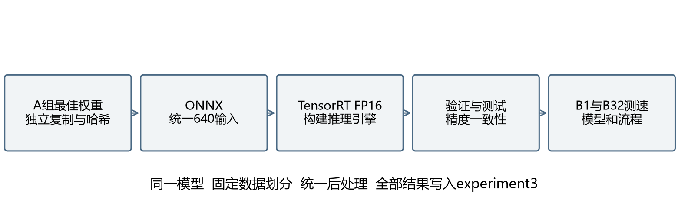

精度与速度分开评估。精度评估保留低置信度候选框以构建PR曲线，展示预测及流程测速使用0.25的置信度阈值，二者对应不同目的。速度再区分模型口径和流程口径：前者用于观察执行后端本身的变化，后者用于观察加速能否传递到包含预处理和后处理的实际调用。

## 3.2.1 数据来源与输入隔离

公共数据延续实验一的固定划分，不重新随机抽样或重新划分。原数据由TACO正式数据、TACO社区数据[2]和SortWaste工业分拣帧组成，共10,528张未增强真实图像、100,496个目标。实验三只需要验证集和测试集，不进行训练或INT8校准，因此没有复制训练集，也没有生成新的增强图片。

表3 实验一划分与实验三实际使用情况

| 子集 | 图片数 | 目标数 | 实验三用途 |
| --- | --- | --- | --- |
| 训练集 | 8,422 | 73,235 | 沿用历史来源，本轮不使用 |
| 验证集 | 1,053 | 14,725 | 运行验证、统一精度对照和测速输入 |
| 测试集 | 1,053 | 12,536 | 固定方案最终精度比较 |

prepare_inputs.py将图片、YOLO标签、COCO标注、模型权重及需要复用的代码独立复制到experiment3，对4,220个输入文件逐一比较复制前后的SHA256。副本不是硬链接或符号链接，模型导出和标签扫描不会通过共享文件修改前两次实验。数据YAML在实验三内生成本机绝对根路径，类别ID保持0至9连续不变。

数据YAML中的train字段只是检测框架格式所需的未使用占位项，本轮没有调用任何训练或校准命令。验证、测试图像已由实验一标准化为640×640 RGB PNG，这里的“原图”指未做额外增强的工作输入，不是网站原分辨率图像。数据来源、分组及许可信息仍以实验一记录为准。

## 3.2.2 FP16推理优化原理

PyTorch FP32基线按32位浮点运行网络，TensorRT方案允许合适的算子采用16位浮点计算。图级与算子级优化是深度学习编译的重要思路[3]，本轮通过TensorRT转换考察此类执行优化的实际效果。与重新学习权重的训练方法不同，本实验改变的是模型的表示与执行方式，目标是在基本维持检测输出质量的条件下缩短推理时间。

FP16具有更低的数值精度和不同的表示范围，权重、激活及中间结果经过低精度计算后可能产生舍入差异[4]。目标检测又包含置信度筛选与NMS，临界位置的小数值变化可能影响候选框是否保留以及框之间的抑制关系。因此“图片看起来相似”或“输出形状相同”不足以证明精度一致，仍需完整数据集上的检测指标。

本轮使用TensorRT 10.13的FP16构建选项，不对每层施加强制精度约束，允许个别层保留FP32；其默认构建策略也可能在适用位置使用TF32。报告因此使用“TensorRT FP16方案”描述允许低精度的引擎，而不声称所有算子均以FP16运行。PyTorch基线关闭TF32，从而明确本轮原生基线的计算设置。

本实验没有做INT8后训练量化，不需要从训练集估计激活校准范围，也不报告量化校准集规模或INT8收益。FP16执行不会减少逻辑网络的参数个数，也不能直接减少算法定义的FLOPs；这些指标与引擎的实际执行速度、融合后图结构及部署文件大小需要分别记录。

## 3.2.3 ONNX转换与TensorRT引擎构建

模型导出从已核对类别名称和顺序的baseline.pt开始。框架先执行推理图融合，再将网络导出为ONNX，保存输入images和输出output0。ONNX提供计算图中间表示，用于转换和检查，本轮不把ONNX Runtime作为额外性能对照后端，也不将该中间步骤扩展为阶段二选做任务。

表4 正式模型导出配置

| 参数 | 本轮取值 | 含义 |
| --- | --- | --- |
| 输入尺寸 | 640×640 | 正式对照固定输入 |
| 导出batch | 32 | 支持本轮最大批量 |
| dynamic | True | 引擎接受profile范围内的动态输入 |
| workspace | 4 GiB | 构建工作空间配置上限 |
| 计算精度 | quantize=16 | 启用TensorRT FP16方案 |
| ONNX opset | 18 | 由实际导出日志记录 |
| simplify | False | 未启用额外ONNX简化 |
| nms | False | NMS由统一后处理执行 |

动态profile由固定版本Ultralytics导出器创建，实际包含最小、最优与最大形状范围；正式评估和测速始终使用640×640及batch=1或32，并未测试整个动态尺寸范围。本轮性能结论仅适用于上述输入尺寸和批量设置。引擎与构建GPU、CUDA及TensorRT运行时有关，移动到新机器时应重新构建。

本次导出调用总耗时704.93秒，约11.75分钟，包含转换、引擎构建及记录等步骤。日志中的策略搜索和编译属于一次性离线成本，正式计时会排除引擎构建和模型加载。本轮保留.pt、.onnx和.engine三个文件及其哈希，既能追溯原始权重，也能区分中间计算图与最终执行产物。

## 3.3 代码实现

表5 实验三文件及职责

| 文件或模块 | 主要职责 |
| --- | --- |
| prepare_inputs.py | 复制输入、逐文件校验和前两次实验保护检查 |
| run_experiment.py | 冻结协议、导出、运行检查、评估与重复测速 |
| predict.py | 任意单图或文件夹检测，保存标框图与JSON |
| src/metrics.py | 从实验二复制，统一类别和逐类指标序列化 |
| configs/protocol.json | 记录模型、测量范围、重复次数和达标口径 |
| records与outputs | 保存环境、输入清单、原始评估和逐次时间 |
| build_figures.py与报告脚本 | 读取已保存记录绘图并生成报告 |

脚本以自身目录解析相对路径，避免终端工作目录变化后读取错误模型或将输出写回实验二。PyTorch为GPU张量计算和模型执行提供框架支持[5]。模型加载时核对固定十类名称和顺序，预测坐标采用原图像素xyxy形式。预测结果同时保存类别ID、类别名称、置信度、位置与输入哈希，图片文件仅用于直观展示，JSON保留可复核的完整结果。

模型导出的核心调用 摘自run_experiment.py

```python
model = YOLO(str(checkpoint))
model.export(format="engine", imgsz=640, batch=32,
             dynamic=True, device=0, workspace=4,
             simplify=False, nms=False, quantize=16)
```

quantize=16是当前固定框架版本表示FP16的参数，不表示本轮进行了INT8量化。旧版本框架使用half参数，脚本通过配置字段检测兼容参数名称，但正式运行以requirements-lock.txt和环境记录中的版本为准。本次导出接口与运行结果对应锁定的框架版本，其他版本的接口兼容性不属于本轮测试范围。

同步计时的核心逻辑 摘自timed函数

```python
for _ in range(warmup):
    call()
torch.cuda.synchronize()
for _ in range(count):
    torch.cuda.synchronize()
    start = time.perf_counter_ns()
    call()
    torch.cuda.synchronize()
    latency_ms = (time.perf_counter_ns() - start) / 1e6
```

预测入口使用OpenCV解码图片，再由框架完成尺寸处理、颜色与张量转换、模型调用及按类别NMS。关于NMS处理重复候选框的作用及不同策略，可参见文献[6]。默认展示阈值为0.25、NMS IoU为0.7、最大检测框数为300。每次预测创建独立输出目录，保存输入和模型哈希，防止重复运行时覆盖上一次案例。单张图片没有保留框可以是有效结果，不等于程序执行失败。

完整评估的主要参数 摘自evaluate函数

```python
model.val(data="configs/data.yaml", split="test",
          imgsz=640, batch=32, rect=False, device=0,
          workers=0, conf=0.001, iou=0.7,
          max_det=300, augment=False, plots=True)
```

上述片段用于说明本轮实际实现，正式脚本还包含类别检查、输出目录、精度参数及元数据记录。原文件保护检查对实验一和实验二的全部文件重新计算哈希，比较新增、缺失和内容变化；导出、正式评估与测速在结果文件已存在时拒绝覆盖，以减少误把不同运行结果混为一组的风险。

## 3.4 测试设计与指标定义

首先用验证集按文件名排序的前四张图片进行运行检查，比较两种后端的原始输出形状并检查非有限值，再分别导出真实标框图片。随后执行完整验证集和测试集评估。小样本检查用于检验链路运行情况及发现明显异常，不能替代1,053张图上的完整精度评价。

表6 完整检测精度评估的统一设置

| 项目 | 取值或说明 |
| --- | --- |
| 输入与批量 | 640×640，batch=32，rect=False |
| 验证与测试 | 各1,053张，沿用实验一划分 |
| 置信度与NMS | conf=0.001；NMS IoU=0.7 |
| 其他约束 | max_det=300；augment=False；workers=0 |
| 主要指标 | mAP50-95；同时报告mAP50、P、R及逐类AP |
| 精度损失 | FP32 mAP减FP16 mAP，单位为百分点 |

本实验采用COCO风格的目标检测评价体系[7]。AP由精确率—召回率曲线计算。mAP50使用IoU=0.5的匹配标准，mAP50-95综合多个IoU阈值，更能同时反映分类和定位质量。NMS IoU=0.7是后处理抑制阈值，与计算AP的匹配阈值作用不同。P和R由框架选择的工作点产生，不能只根据Precision的升降判断整体模型更好。

正式测速从验证集中按固定间隔选取32张图片，并记录文件名与哈希。batch=1使用该固定列表的首张，batch=32使用全部32张。模型口径使用预先准备的GPU输入，到网络原始输出为止；流程口径从已解码的CPU BGR图像开始，包含预处理、上传、推理、NMS及Results封装，不含磁盘读取、绘图和保存。

表7 正式计时重复设计

| 口径 | Batch | 每轮次数 | 轮数 | 每后端总次数 |
| --- | --- | --- | --- | --- |
| 模型 | 1 | 100 | 3 | 300 |
| 模型 | 32 | 40 | 3 | 120 |
| 流程 | 1 | 50 | 3 | 150 |
| 流程 | 32 | 20 | 3 | 60 |

每个条件每轮开始预热30次，轮间交替FP32与TensorRT的执行顺序，以减轻固定顺序对温度、缓存和系统状态的影响。四种条件、两种后端累计1,260条有效计时。报告均值、中位数、P95和样本标准差；重复计时反映本次运行波动，不等同于独立训练重复或跨设备统计检验。

设固定batch为B，平均批次延迟为T毫秒，则吞吐量为Q=1000B/T。延迟降低比例为1−T优化/T基线，吞吐量提升比例为Q优化/Q基线−1，加速倍数为T基线/T优化。相同batch下吞吐量由同一延迟换算，两者不是两项独立实验；批量平均每图耗时T/B也不能替代一张图片的请求等待时间。

## 3.5 实际运行步骤与过程检查

实际执行顺序为准备输入、initialize、export、smoke、val、test、benchmark和原文件核验。环境初始化记录Python、Torch、CUDA、TensorRT及GPU信息，并生成本地数据YAML与冻结协议。模型导出完成后先进行运行检查；验证集通过后，在不更改方案的条件下执行测试，再开展固定输入的测速。

Windows沙箱曾拒绝数据扫描线程池所需的命名管道，首次验证在扫描阶段退出，未产生完整评估摘要。解决时保留失败日志，在允许该系统调用的运行环境中重新执行；数据目录和输出仍限定在experiment3，没有通过改写标签或缩小评估数据规避问题。后续完整验证与测试均有completed状态和逐类结果。

实验分析使用已保存的正式运行记录。案例统计由预测JSON与对应验证标签计算，延迟图表由逐次计时CSV汇总生成，精度对照和混淆差值由完整评估摘要及混淆矩阵计算得到。各项图表与原始记录保持对应，便于复核实验结果。

# 四 实验关键技术与难点

## 4.1 检测任务中的数值一致性

检测输出同时包含像素尺度的坐标和0至1的类别分数。直接对整张输出张量报告一个最大绝对差，会把不同量纲混在一起；原始张量还包含大量最终不会保留的候选框。因此运行检查保存数值差异以便诊断，正式结论则依据完整mAP及经过后处理的预测框，不能把原始张量中某个较大差值直接解释为最终定位错误。

两种后端在四张运行检查图上的输出形状均为[4,14,8400]，与十类检测输出一致，但形状相同只是接口检查。报告进一步比较所有类别的AP和实例数，在局部案例中核对框数、类别及坐标变化，区分“后端行为相近”和“检测本身正确”。二者是不同的问题。

## 4.2 GPU异步执行与计时边界

CUDA操作通常由CPU异步提交。如果只在Python调用前后计时，CPU可能在GPU计算尚未结束时就读到时间，得到偏小的结果。timed函数在调用前后都执行torch.cuda.synchronize，保证记录包含该次工作的完成等待。这种主机同步计时也包含Python调用成本，因此报告不把它称为仅GPU内核执行时间。

模型加载、引擎构建和预热需要单独处理。首次调用可能触发缓存建立与运行时初始化，不能与稳定运行混算。本轮排除这些离线或初始化阶段，正式计时每轮使用相同预热规则。图像读写、绘图和JSON保存则留在预测演示的总耗时中，不能拿该总耗时与模型口径直接比较。

## 4.3 模型加速与完整流程收益的差异

完整调用除了网络计算，还包括CPU图像组织、数据搬运、按类别NMS和结果对象创建。即使网络部分显著加速，共同开销也可能限制总流程改善[8]。任务书同时要求构建完整pipeline，所以本实验没有仅保留模型计时，而是明确报告两种范围。

本轮batch=32出现模型推理降低69.45%、完整流程只降低0.94%的差异。这说明在当前通用接口及输入条件下，模型加速没有等比例传递到整个流程。现有记录没有对每个算子和每次搬运逐项剖析，因此只能指出这一现象及合理分析方向，不能精确断言CPU预处理、NMS或某一内存操作分别占用了多少比例。

原始模型和流程计时来自不同调用路径，不宜简单相减后把剩余部分当作某个确定模块的耗时，也不能据此拟合未经验证的瓶颈比例。本轮记录反映了批量流程加速有限的现象，但不提供各处理阶段的独立耗时；因此，未达标结论与具体瓶颈归因分别处理。

## 4.4 参数量 计算量与文件大小的解释

原始未融合网络有2,607,070个参数，640输入理论计算量约6.579 GFLOPs。推理时两种后端均使用融合，融合可能改变运行图中的层数和显式参数表示，但本轮没有删除网络通道或改变检测头容量。因此不把TensorRT加速解释为结构剪枝，也不宣称逻辑参数量或理论算法计算量减少。

原.pt文件内的存储精度与其被加载后使用FP32计算是两个概念。TensorRT引擎还保存执行策略和其他运行信息，序列化文件可以比原checkpoint更大；FP16并不保证最终.engine一定只有.pt的一半。报告同时保留三种产物的字节数，不将不同格式文件的大小差直接当作权重量化压缩率。

## 4.5 资源口径与复现边界

PyTorch显存分配统计只覆盖其管理的内存，不完整覆盖TensorRT外部分配。用PyTorch峰值去比较两种后端，可能把没有被统计的引擎内存误写成节省。本轮没有可靠的统一总显存峰值对照，因此不报告总显存减少比例；4 GiB workspace也是构建配置，不等于运行峰值或整张显卡的总占用。

本轮结果来自一台Windows电脑、一张GPU、一个已训练checkpoint和固定输入设置。三轮计时能够描述当前运行波动，不能代表所有硬件。依赖锁定文件、输入与模型哈希、评估参数及输出目录共同构成复现依据；换机器后应重新构建引擎并重新测量，不能直接承诺保留相同加速倍数。

## 4.6 原实验保护与结果追踪

数据准备阶段保存实验一、二的文件清单与哈希，并对复制输入逐项验证。运行阶段所有缓存、导出和结果在实验三写入，正式结果存在时拒绝覆盖；结束后再次比较349个原文件。校验结果表明本轮改动仅发生在实验三，前两次实验的权重和报告保持不变。

哈希证明对应文件内容相同，不证明数据标签绝对正确，也不替代模型精度评估。输入标注哈希可识别当前数据版本，但若只对COCO文件做哈希，不能把它称为全部图像像素的指纹。本轮复制清单与标注指纹分别保存，报告按各自实际含义使用。

# 五 实验结果与分析

## 5.1 模型导出与真实运行结果

表8 模型产物与链路检查

| 项目 | 实际结果 | 说明 |
| --- | --- | --- |
| 原模型副本 | 5.256 MiB | 与实验二A组best.pt哈希一致 |
| ONNX模型 | 10.005 MiB | opset18，ONNX检查通过 |
| TensorRT引擎 | 10.880 MiB | FP16方案，动态profile |
| 导出调用耗时 | 704.93 s | 一次性离线成本 |
| 运行检查 | 4张图，两后端均完成 | 输出[4,14,8400] |
| 独立预测CLI | 4张验证图处理成功 | 生成标框图与JSON |

模型副本SHA256与实验二A组记录一致，说明对照使用的是相同来源的训练权重，而不是重新下载的通用预训练模型。ONNX与引擎各有独立哈希，导出日志同时保存输入输出名称与形状。真实预测生成的可视化和JSON表明优化引擎已接入完整Python调用流程。

导出成功只说明模型可以被构建和执行，不能自动证明优化达到速度或精度目标。以下分别给出完整检测评估、可复核的逐次计时汇总及案例分析。所有百分数由保存的0至1指标转换，显示时按需要保留小数位，差值由未四舍五入的原始数值计算。

## 5.2 验证集与测试集精度对照

表9 统一设置下的完整检测指标

| 子集与后端 | Precision | Recall | mAP50 | mAP50-95 |
| --- | --- | --- | --- | --- |
| 验证 FP32 | 31.4789% | 27.9956% | 21.5980% | 15.5293% |
| 验证 TRT FP16 | 31.0641% | 27.9113% | 21.5938% | 15.5271% |
| 测试 FP32 | 34.3740% | 31.2603% | 24.4520% | 17.5281% |
| 测试 TRT FP16 | 34.0576% | 31.3284% | 24.4383% | 17.5155% |

验证集mAP50-95从15.5293%变为15.5271%，绝对损失约0.0022个百分点。测试集mAP50-95从17.5281%变为17.5155%，绝对损失0.0126个百分点，相对下降约0.0720%。按主指标绝对损失不超过1个百分点的口径，精度一致性目标达到；相对损失也低于1%。

Precision、Recall和mAP并不总是同方向变化。本轮测试Precision略降、Recall略升，而mAP50和mAP50-95均有很小下降。这种组合需要结合阈值工作点和完整PR曲线理解，不能将Recall的小幅升高写成模型识别能力全面提升，也不能把所有数值差异都解释为已被证明的某种误差机制。

实验二历史独立评估采用rect=True、batch=16，本轮统一使用rect=False、batch=32与固定640输入；输入布局和批次等配置不同，因此本轮FP32的绝对分数不必与历史表完全相同。优化差值仅由本轮同设置的两种后端计算，历史17.46%不能直接拿来减去本轮FP16分数作为加速后的精度损失。

## 5.3 模型推理延迟与吞吐量

表10 模型口径平均延迟与吞吐量

| Batch | 后端 | ms每批 | ms每图 | 图每秒 |
| --- | --- | --- | --- | --- |
| 1 | FP32 | 18.587 | 18.587 | 53.8 |
| 1 | TRT FP16 | 2.485 | 2.485 | 402.4 |
| 32 | FP32 | 41.292 | 1.290 | 775.0 |
| 32 | TRT FP16 | 12.614 | 0.394 | 2536.8 |

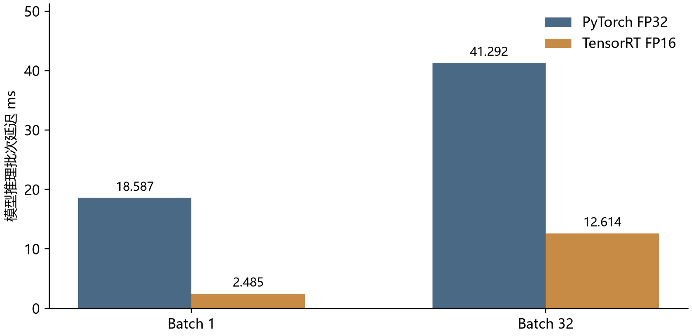

单图模型调用从18.587 ms降至2.485 ms，延迟降低86.63%，加速约7.48倍，吞吐量从53.8图/秒增至402.4图/秒。batch=32的批次延迟从41.292 ms降至12.614 ms，延迟降低69.45%，加速约3.27倍，换算吞吐量从775.0图/秒增至2,536.8图/秒。两个batch条件均达到延迟降低40%和吞吐提升50%的目标。

单图与批量的加速倍数不同，反映框架调用、内核组织及硬件利用情况随batch变化。上述结果包含同步的Python调用至网络原始输出，不包含上传、NMS或磁盘操作。它支持“当前设置下模型执行显著加速”，不能直接支持“每张用户上传图片都只需要2.485 ms处理完成”。

## 5.4 完整推理流程的收益与未达标项

表11 流程口径平均延迟与吞吐量

| Batch | 后端 | ms每批 | ms每图 | 图每秒 |
| --- | --- | --- | --- | --- |
| 1 | FP32 | 24.074 | 24.074 | 41.5 |
| 1 | TRT FP16 | 8.406 | 8.406 | 119.0 |
| 32 | FP32 | 176.871 | 5.527 | 180.9 |
| 32 | TRT FP16 | 175.202 | 5.475 | 182.6 |

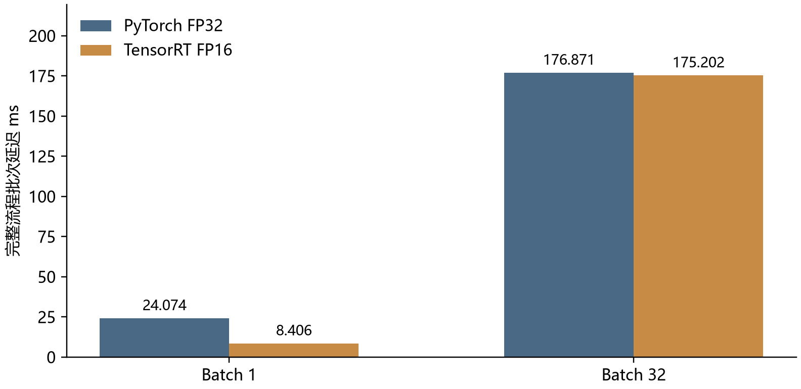

单图流程从24.074 ms降至8.406 ms，延迟降低65.08%，吞吐量从41.5图/秒增至119.0图/秒，说明模型收益能够明显传递到当前单图调用。与模型口径相比，流程耗时更长且加速比例较低，符合额外阶段共同参与处理的事实。

batch=32流程从176.871 ms变为175.202 ms，平均延迟仅降低0.94%，吞吐量从180.9图/秒变为182.6图/秒，提升约0.95%。该条件未达到目标。结合两种后端的P95与轮间波动，均值差异较小，且本轮未进行统计检验，现有结果不足以支持稳定、显著的批量整体性能改善。

从应用场景看，当前方案在单张图片处理方面已有明确收益；在32张图片组成批次时，完整流程的提升有限，纯模型吞吐量不能代表整体处理速度。本轮未测量调用和数据处理各阶段的独立耗时，因此批量流程瓶颈尚无直接的分阶段计时依据。

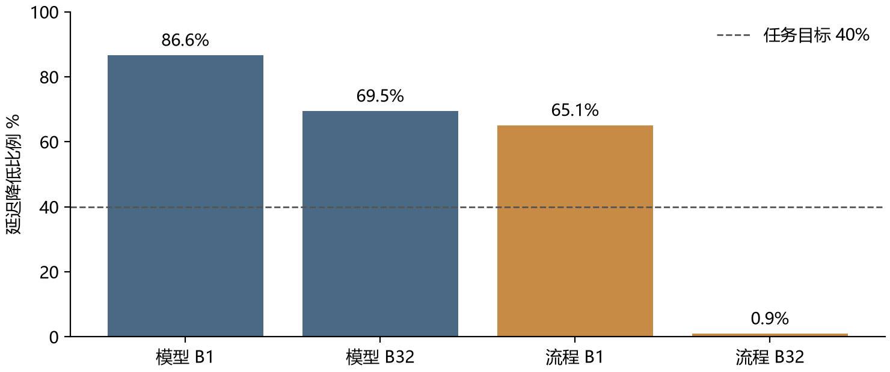

## 5.5 计时分布与运行稳定性

表12 模型口径延迟分布 单位为毫秒每批

| Batch | 后端 | 中位数 | P95 | 标准差 |
| --- | --- | --- | --- | --- |
| 1 | FP32 | 18.250 | 20.788 | 1.224 |
| 1 | TRT FP16 | 2.463 | 2.743 | 0.149 |
| 32 | FP32 | 40.956 | 42.764 | 0.872 |
| 32 | TRT FP16 | 12.489 | 13.158 | 0.414 |

表13 流程口径延迟分布 单位为毫秒每批

| Batch | 后端 | 中位数 | P95 | 标准差 |
| --- | --- | --- | --- | --- |
| 1 | FP32 | 23.943 | 25.822 | 0.956 |
| 1 | TRT FP16 | 8.288 | 10.656 | 1.098 |
| 32 | FP32 | 171.724 | 201.458 | 10.922 |
| 32 | TRT FP16 | 172.416 | 192.124 | 9.494 |

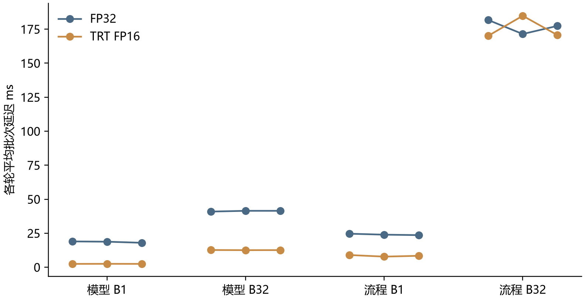

模型单图的FP32中位数约18.250 ms、P95约20.788 ms；TensorRT对应约2.463 ms和2.743 ms，均与各自均值处于相近范围。模型batch=32的两种后端也保持明显分离，支持本轮模型口径的加速观察。

流程batch=32的FP32 P95约201.458 ms，TensorRT约192.124 ms，标准差分别约10.922 ms和9.494 ms，显示单次调用存在可见波动。TensorRT单图流程P95约10.656 ms，也高于8.406 ms均值，实际交互体验不能只看平均数。三轮顺序交替能够减少部分偏差，仍不能消除桌面系统活动和硬件状态的所有影响。

## 5.6 逐类AP与数据分布的关联

表14 测试集逐类AP50-95与真值数量

| 类别 | 目标数 | FP32 AP | FP16 AP | 变化百分点 |
| --- | --- | --- | --- | --- |
| 硬质塑料 | 7239 | 53.686% | 53.675% | -0.0112 |
| 软质塑料 | 1679 | 16.307% | 16.285% | -0.0217 |
| 形态不明塑料 | 48 | 1.909% | 1.910% | +0.0011 |
| 纸及纸板 | 373 | 11.276% | 11.277% | +0.0017 |
| 复合包装 | 2710 | 55.877% | 55.863% | -0.0135 |
| 金属 | 283 | 17.243% | 17.203% | -0.0399 |
| 玻璃 | 20 | 12.781% | 12.762% | -0.0188 |
| 食物残余 | 2 | 0.358% | 0.362% | +0.0044 |
| 烟蒂 | 100 | 3.122% | 3.088% | -0.0343 |
| 特殊及不明垃圾 | 82 | 2.724% | 2.730% | +0.0062 |

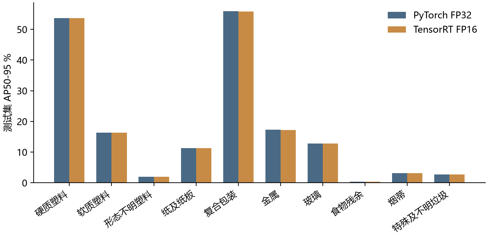

硬质塑料和复合包装在本轮FP32测试中AP50-95分别约53.686%和55.877%，明显高于若干其他类别；两类真值目标也分别有7,239个和2,710个。该结果延续了模型覆盖不均的特点。FP16转换保持了总体性能，但没有解决类别不平衡或少数类学习不足，不能把推理加速当作检测能力改进实验。

十类变化总体很小。金属的AP50-95绝对下降约0.0399个百分点、烟蒂约0.0343个百分点，软质塑料约0.0217个百分点；部分低AP类别出现很小上升。这些变化不应只用相对百分比放大解读，因为某些类别原始AP已经很低。食物残余仅2个测试目标，玻璃仅20个，单个目标对该类结果的影响可能较大。

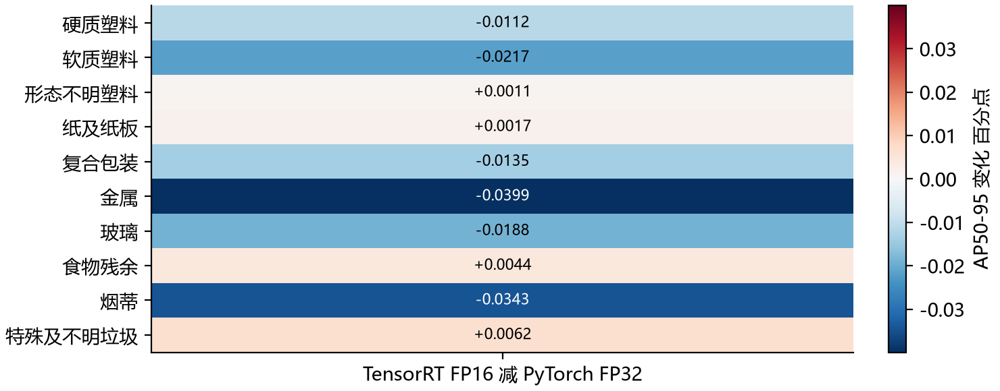

热力图展示各类AP变化，颜色以零为中心，数值单位为百分点。它定位哪些类别指标变化较多，不是逐层量化误差图，也不是分类错误率。实验一的多来源、多目标、遮挡与小目标特点为解释检测困难提供背景，但本轮没有按来源或目标尺度单独计算AP，不能据此宣布某个来源或尺寸组更耐受FP16误差。

## 5.7 混淆矩阵变化分析

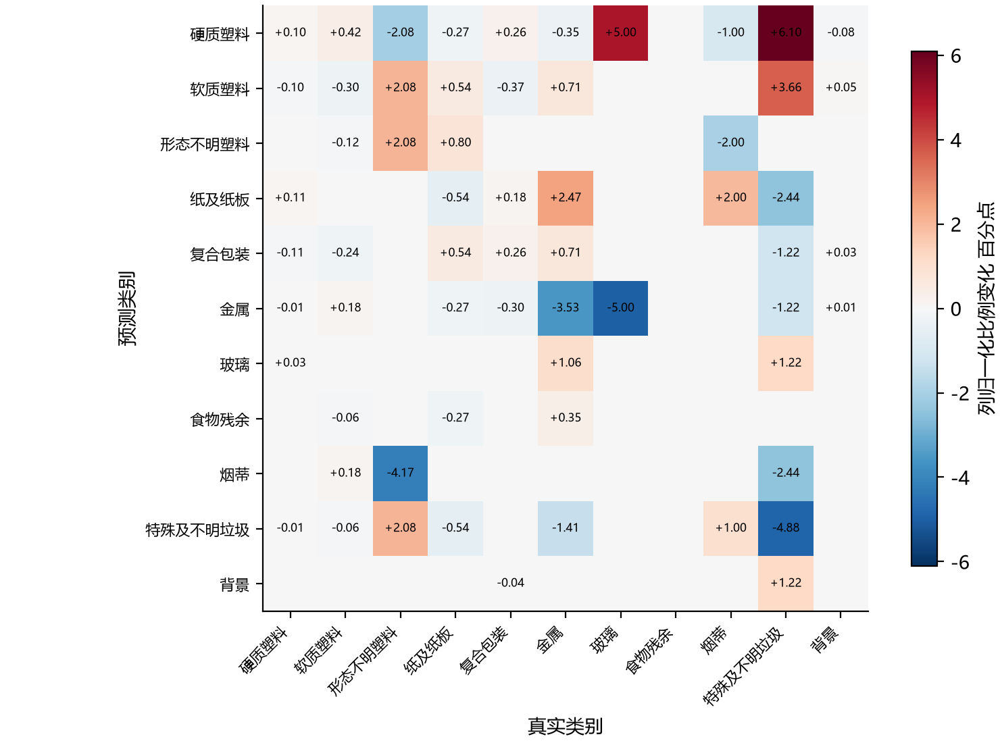

矩阵纵轴为预测类别、横轴为真实类别，分别对两种后端矩阵按列归一化后求差。背景行对应真实目标未匹配到有效预测的部分，背景列反映未匹配预测的类别分布。列内正负值表示对应比例的变化，不能把每个色块都当成某一类别的AP变化。

少数类的归一化分母较小，几个目标的变化就可能在差值图上表现为较明显颜色，而总体AP仍几乎不变。因此读取混淆差值时必须结合上一表的样本数量。框架混淆矩阵采用独立默认统计规则，不等同于PR曲线覆盖的全部置信度范围，也不等于P/R选定工作点。

图中变化为后端执行差异的结果描述，没有逐层激活误差、精度约束或NMS消融等证据。本轮结果表明完整指标差异很小、局部混淆存在变化；现有证据不支持将变化归因于某一网络层、材质反光或特定数据来源。

## 5.8 独立预测与局部案例核对

运行检查使用验证目录按文件名排序的前四张图片000005、000013、000017和000023。两种后端均采用展示阈值conf=0.25和NMS IoU=0.7。为增加可复核性，报告从已保存JSON读取预测，并对照相应YOLO标签按置信度从高到低进行同类一对一匹配，匹配IoU≥0.5计为TP，未匹配预测计FP，未匹配真值计FN。

表15 四张验证案例的局部匹配结果 数值为FP32与FP16

| 图片 | 真值 | 预测框 | TP | FP | FN |
| --- | --- | --- | --- | --- | --- |
| 000005.png | 6 | 6/6 | 3/3 | 3/3 | 3/3 |
| 000013.png | 4 | 0/0 | 0/0 | 0/0 | 4/4 |
| 000017.png | 1 | 2/2 | 1/1 | 1/1 | 0/0 |
| 000023.png | 4 | 4/4 | 2/2 | 2/2 | 2/2 |

四张图共有15个真值目标，每种后端均输出12个框，匹配得到TP=6、FP=6、FN=9。此处的框数和匹配计数在两个后端间一致，但预测置信度与坐标存在细小变化。样本是固定路径顺序选取的运行检查图，不是随机抽样，计数只用于解释案例，不能换算为整个验证集或测试集的性能结论。

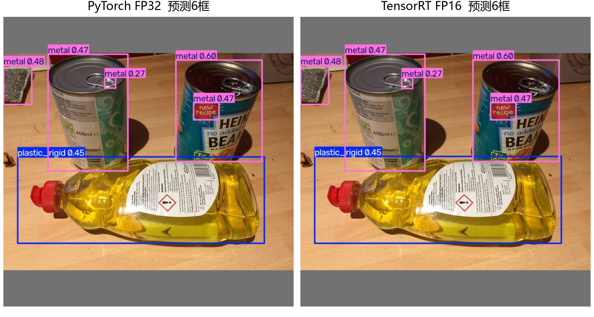

000005中可见金属容器和塑料瓶等目标。两种后端都输出6个框，但与6个真实目标比较均只有3个同类框成功匹配，同时有3个FP和3个FN，所以“输出框数等于真值数”并不代表全部检出。跨后端匹配的框IoU均不低于约0.9972，最大置信度绝对变化约0.00605，显示执行转换的局部结果接近，而既有误检仍然存在。

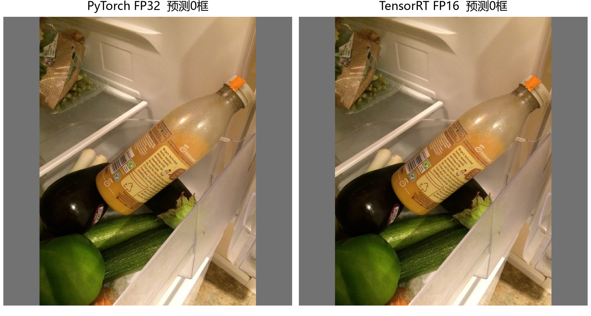

000013的真实标签含4个目标，两种后端在conf=0.25下均没有保留预测框，FN均为4。脚本状态正常，因此这是检测覆盖不足的案例，而不是引擎执行失败。由于展示JSON未保存低于阈值的所有候选框，不能断言网络完全没有候选输出，也不能把该图的漏检归因于FP16。

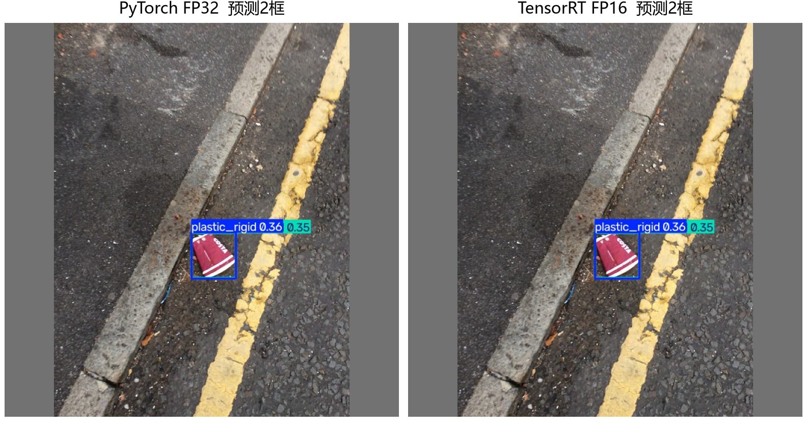

000017中同一区域同时出现硬质塑料和纸及纸板两个类别框，两后端均为2个预测、1个TP和1个FP。当前NMS按类别执行，不同类别的重叠框可以同时保留；截图中的文字相互覆盖也可能遮住下层类别。因此应结合JSON理解结果，不能只依据最上层可见标签认定模型只有一个判断。

000023两种后端均输出4框，但与4个真值对应后均为2个TP、2个FP和2个FN，进一步说明相近输出不等于检测已经充分正确。四图之间匹配的预测坐标最大绝对变化不超过约0.337像素，这只能支持这些局部框的位置相近；完整精度仍以全量评估表为准。

## 5.9 模型资源与实验目标核对

表16 逻辑模型与实际部署文件对照

| 指标 | PyTorch基线 | TensorRT方案 |
| --- | --- | --- |
| 逻辑参数量 | 2,607,070 | 相同网络 |
| 理论计算量 | 6.579 GFLOPs | 相同算法计算量 |
| 序列化文件 | 5.256 MiB | 10.880 MiB |
| 主要执行设置 | FP32，关闭TF32 | 允许FP16的引擎策略 |
| 总显存节省 | 未建立统一口径 | 不报告节省比例 |

表17 延迟降低40%与吞吐提升50%的目标核对

| 条件 | 延迟降低 | 吞吐提升 | 判断 |
| --- | --- | --- | --- |
| 模型 B1 | 86.63% | 647.93% | 达到 |
| 模型 B32 | 69.45% | 227.34% | 达到 |
| 流程 B1 | 65.08% | 186.41% | 达到 |
| 流程 B32 | 0.94% | 0.95% | 未达到 |

模型单图、模型批量32和单图流程的速度目标达到；批量32完整流程未达到。测试集mAP50-95绝对损失0.0126个百分点，精度损失目标达到。原始实验文件保护检查通过，完整实现、评估与报告材料齐备，但“实验已完成”不等于“所有性能条件都已达到”，两者在结论中分别说明。

# 六 实验总结与展望

本实验完成了实验二主模型在推理阶段的优化链路：隔离复制输入、核对类别与文件内容、导出ONNX、构建TensorRT FP16引擎、实现图片检测接口、进行完整精度对照、重复测量两种batch的模型与流程速度，并保存逐类指标、混淆差值和预测案例。实验一提供可追溯的数据与划分，实验二提供已训练权重，实验三在这一基础上研究执行效率，三次实验的职责和成果保持可区分。

在当前RTX 4070 SUPER与固定配置下，TensorRT方案显著缩短模型推理时间，且测试集mAP50-95仅下降约0.0126个百分点。单图完整流程也获得明显改善，说明该后端对当前单图检测原型具有实际价值。与此同时，批量32完整流程几乎没有改善，提醒我们同时关注模型、输入处理、后处理及接口管理，不能只凭网络计算的高吞吐量判断整体应用能力。

本轮没有解决模型原有的类别不平衡、复杂场景漏检和跨类别重复框等问题。部分案例在两种后端之间几乎一致，却同时存在误检和漏检；这说明精度一致性与任务本身的准确程度需要分别评价。少数类样本很少、工业来源共享视频等数据边界也仍然存在，当前结果不足以证明校园新场景或跨设备的泛化表现。

后续优化方向主要包括批量流程的分阶段性能分析，以及预处理组织、内存搬运和后处理实现的改进。CPU或边缘部署、多设备对照与新增训练实验属于后续研究范围。本轮结论以当前固定模型、输入设置和完整评估记录为依据。

# 七 参考文献

[1] REDMON J, DIVVALA S, GIRSHICK R, et al. You Only Look Once: Unified, Real-Time Object Detection[C]//2016 IEEE Conference on Computer Vision and Pattern Recognition. 2016: 779-788. DOI: 10.1109/CVPR.2016.91.

[2] PROENÇA P F, SIMÕES P. TACO: Trash Annotations in Context for Litter Detection[EB/OL]. (2020-03-16)[2026-10-26]. https://arxiv.org/abs/2003.06975. DOI: 10.48550/arXiv.2003.06975.

[3] CHEN T, MOREAU T, JIANG Z, et al. TVM: An Automated End-to-End Optimizing Compiler for Deep Learning[C]//13th USENIX Symposium on Operating Systems Design and Implementation. USENIX Association, 2018: 578-594.

[4] MICIKEVICIUS P, NARANG S, ALBEN J, et al. Mixed Precision Training[C/OL]//International Conference on Learning Representations. 2018[2026-10-26]. https://openreview.net/forum?id=r1gs9JgRZ.

[5] PASZKE A, GROSS S, MASSA F, et al. PyTorch: An Imperative Style, High-Performance Deep Learning Library[C]//Advances in Neural Information Processing Systems. 2019, 32: 8024-8035.

[6] BODLA N, SINGH B, CHELLAPPA R, et al. Soft-NMS—Improving Object Detection with One Line of Code[C]//2017 IEEE International Conference on Computer Vision. 2017: 5562-5570. DOI: 10.1109/ICCV.2017.593.

[7] LIN T Y, MAIRE M, BELONGIE S, et al. Microsoft COCO: Common Objects in Context[C]//Computer Vision—ECCV 2014. Cham: Springer, 2014: 740-755. DOI: 10.1007/978-3-319-10602-1_48.

[8] AMDAHL G M. Validity of the Single Processor Approach to Achieving Large Scale Computing Capabilities[C]//Proceedings of the April 18-20, 1967, Spring Joint Computer Conference. New York: ACM, 1967: 483-485. DOI: 10.1145/1465482.1465560.
