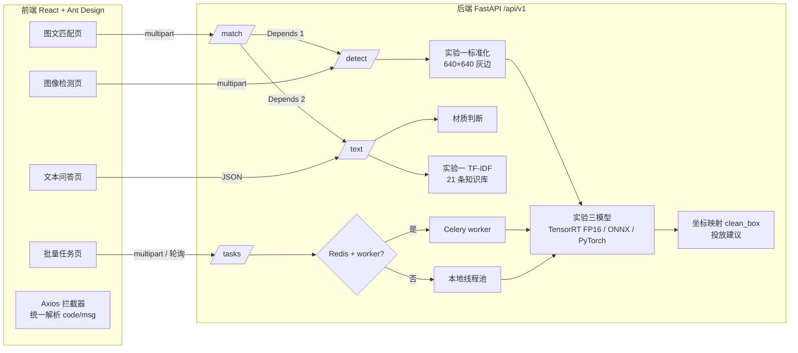

# 实验四：循智 EcoSort 前后端

把实验二训练、实验三加速的 YOLO11n 垃圾检测模型封装成 Web 应用：前端上传照片 / 输入文字，后端推理并返回目标框、材质类别、置信度和投放建议。

```
experiment4/
├─ backend/                 FastAPI 后端
│  ├─ app/
│  │  ├─ main.py            入口：CORS、统一异常、路由、托管前端 dist
│  │  ├─ config.py          路径与参数（可用 ECOSORT_* 环境变量覆盖）
│  │  ├─ reuse.py           导入 experiment1.py，复用 clean_box、prepare_documents、类别名
│  │  ├─ preprocess.py      与实验一一致的 640×640 等比缩放 + 灰边标准化
│  │  ├─ detector.py        加载实验三模型（TensorRT / ONNX / PyTorch），预热、加锁推理、自动回退
│  │  ├─ service.py         检测流程：校验 → 标准化 → 推理 → 坐标映射 → 投放建议
│  │  ├─ advice.py          材质 → 四分类投放建议（通用 / 上海）
│  │  ├─ text_service.py    文本材质判断 + 21 条知识库 TF-IDF 检索
│  │  ├─ tasks.py           异步批量任务（Celery 或本地线程池）
│  │  ├─ celery_app.py      Celery + Redis
│  │  ├─ errors.py          {code, result, msg} 与错误码
│  │  └─ routers/           detect / text / match / tasks / meta
│  ├─ scripts/build_engine.py   在本机显卡上重建 TensorRT 引擎
│  ├─ tests/test_api.py     接口测试（pytest）
│  └─ requirements.txt
├─ frontend/                React 19 + Ant Design 6 + Axios（Vite）
│  └─ src/pages/            图像检测、文本问答、图文匹配、批量任务、接口与模型
├─ frontend_prototype/      最初的静态 HTML 原型
├─ docker-compose.yml       redis + backend + worker + frontend(nginx)
└─ start_backend.bat / start_frontend.bat / start_worker.bat
```

## 运行（Windows）

### 1. 后端环境（一次）

```powershell
conda create -n ecosort-web python=3.12 -y
conda activate ecosort-web
# RTX 50 系显卡需要 CUDA 12.8 及以上版本的 PyTorch
pip install torch==2.11.0 torchvision==0.26.0 --index-url https://download.pytorch.org/whl/cu128
cd experiment4\backend
pip install -r requirements.txt
```

PyCharm：设置 → 项目 → Python 解释器 → 添加解释器 → Conda 环境 → 选择 `ecosort-web`。

### 2. 重建 TensorRT 引擎（换显卡后一次）

`experiment3/models/baseline.engine` 是在 RTX 4070 SUPER 上构建的，TensorRT 引擎与显卡架构绑定，换到其他显卡无法加载。后端检测到后会自动改用 PyTorch / ONNX，并在“接口与模型”页显示原因。要用 TensorRT 加速：

```powershell
cd experiment4\backend
python scripts\build_engine.py
```

脚本把 `baseline.pt` 复制到 `backend/models/` 后导出，不改动 experiment3。完成后重启后端，`tensorrt_fp16` 会显示“已加载”。

### 3. 启动

```powershell
# 终端 1：后端（http://localhost:8000，接口文档 /docs）
cd experiment4\backend
uvicorn app.main:app --host 0.0.0.0 --port 8000

# 终端 2：前端开发服务器（http://localhost:5173，Node.js 24）
cd experiment4\frontend
npm install
npm run dev
```

也可以双击 `start_backend.bat`、`start_frontend.bat`（先在终端里激活 conda 环境再运行更稳妥）。

只想开一个端口：在 `frontend` 运行一次 `npm run build`，之后只启动后端，访问 http://localhost:8000 即可，后端会托管 `frontend/dist`。

### 在 PyCharm + HBuilderX 中运行

**后端（PyCharm）**
1. 文件 → 设置 → 项目 → Python 解释器 → 添加解释器 → Conda 环境，选择 `ecosort-web`。
2. 在项目窗口找到 `experiment4/backend/run.py`，右键 → 运行 'run'。
3. 控制台出现 `Uvicorn running on http://0.0.0.0:8000` 即可。运行测试：右键 `backend/tests` → 运行 'pytest'。

**前端（HBuilderX）**
1. 确认电脑上的 Node.js 版本：在命令行运行 `node -v`，需要 20.19 以上（任务书要求 24）。
2. 文件 → 打开目录，选择 `experiment4/frontend`。
3. 在 HBuilderX 底部的终端里运行一次 `npm install`。
4. 运行 → 运行到终端 → `dev - vite`，然后在浏览器打开 http://localhost:5173 。
5. 不要用“运行到浏览器”或“运行到内置浏览器”：那只会直接打开静态文件，不会编译 React 代码，页面是空白的。

### 4. Celery 异步任务（可选）

没有 Redis 时，批量任务在后端进程内的线程池执行，接口和状态完全相同。要演示分布式队列：

```powershell
docker run -d -p 6379:6379 redis:7-alpine   # 或 Memurai / WSL 中的 redis-server
cd experiment4\backend
celery -A app.celery_app worker --pool=solo -l info    # Windows 必须 --pool=solo
```

后端每 15 秒探测一次，发现 Redis 和 worker 在线后，新任务自动交给 Celery。

### 5. 测试

```powershell
cd experiment4\backend
python -m pytest tests -q
```

## 架构与数据流



核心流程：前端校验（格式、10 MB、文本长度）→ Axios POST → FastAPI 接收 → 实验一同款预处理 → 实验三模型推理 → `{"code", "result", "msg"}` → 前端渲染框和建议。

**如何适配实验一的数据**
- 图片：实验一把全部图片等比缩放到 640×640、居中贴在 (114,114,114) 灰底上。后端对上传图片做同样处理（`preprocess.standardize`），再把框映射回原图坐标，并用实验一的 `clean_box` 裁剪越界部分。前端用 `object-fit: contain` 显示图片，正好和这种灰边方式对齐，640 坐标的框可以直接叠加。
- 文本：知识库来自实验一清洗后的 21 条辅助文本（`data/split/summary.json`），直接调用实验一的 `prepare_documents` 做字符 2-4 gram TF-IDF。
- 类别：十类材质名、顺序与实验二、三一致；后端加载模型时会核对，不一致就拒绝使用。

**如何集成实验三的模型**
- 三个后端都来自同一份权重（实验二 A 组 `best.pt`）。推理参数与实验三一致：imgsz=640、NMS IoU=0.7、max_det=300。半精度参数沿用实验三的 `precision_args`。
- 启动时逐个加载并预热；某个后端失败（文件缺失、引擎不兼容）就记录原因跳过，请求会自动回退到可用后端，并在 `msg` 里说明。
- Ultralytics 模型对象不是线程安全的，所以每个后端单独加锁，避免并发请求互相干扰。

## API

| 方法 | 路径 | 参数 | 返回 `result` 主要字段 |
| --- | --- | --- | --- |
| GET | `/api/v1/health` | — | device、gpu、backends[]（是否可用、错误原因、预热耗时）、knowledge_base、tasks.mode |
| GET | `/api/v1/classes` | — | 十类材质与默认投放规则 |
| GET | `/api/v1/samples` | — | 示例图片（实验三验证集） |
| POST | `/api/v1/detect` | multipart：`file`，`conf`=0.25，`backend`，`region` | detections[]{class_id, name_zh, confidence, box, box_original, advice}、bins、timing_ms |
| POST | `/api/v1/text` | JSON：`{"text","region"}` | top、ranking[]、contaminated、advice、evidence[] |
| POST | `/api/v1/match` | multipart：`file`，`text` | verdict（consistent / partial / inconsistent / unknown）、score、workflow[] |
| POST | `/api/v1/tasks` | multipart：`files[]`，或 `source=validation&count=N` | task_id、state、mode |
| GET | `/api/v1/tasks/{id}` | — | state、done/total、progress、objects |
| GET | `/api/v1/tasks/{id}/result` | — | 每张图片的检测结果与汇总 |

调用示例（实验三验证集 000005.png）：

```powershell
curl -F "file=@experiment3/data/images/val/000005.png" -F "conf=0.25" http://localhost:8000/api/v1/detect
```

```json
{"code":200,"msg":"ok","result":{"count":6,"backend_used":"tensorrt_fp16",
 "detections":[{"class_id":5,"name_zh":"金属","confidence":0.599,
   "box":{"x1":380.9,"y1":95.4,"x2":570.7,"y2":319.8},
   "advice":{"bin":"recyclable","bin_zh":"可回收物","needs_review":false}}, "..."],
 "timing_ms":{"model_inference":"…","total":"…"}}}
```

### 错误码

| code | 场景 | 示例 msg |
| --- | --- | --- |
| 400 | 输入错误：格式不是 JPG/PNG、图片损坏、缺少文件、文本为空或超 300 字、conf 越界 | 图像格式错误，请上传 PNG/JPG |
| 403 | 设置了 `ECOSORT_API_KEY`，请求未带正确的 `X-API-Key` | 缺少或错误的 X-API-Key |
| 404 | 路径或任务 ID 不存在 | 接口路径不存在，请检查 URL 和版本号（/api/v1） |
| 413 | 单图超过 10 MB，或批量超过 64 张 | 图片大小 12.3 MB，超过 10 MB 上限 |
| 500 | 模型推理失败 / 没有可用模型 | 模型推理失败：RuntimeError |
| 503 | `ECOSORT_TASK_MODE=celery` 但 Redis / worker 不可用 | 任务队列不可用 |

前端 Axios 拦截器把以上错误和网络错误（后端没启动、超时）统一转成提示文字，显示在页面顶部。

## 已验证

在云端测试环境（CPU，无 GPU）上：
- `pytest`：12 项全部通过。000005.png 的检测结果（6 个目标，金属 0.599 等）与实验三 `smoke_predictions` 一致，PyTorch 与 ONNX 两个后端输出相同。
- Celery 模式：Redis + `celery worker --pool=solo` 实际跑通 PENDING → STARTED → SUCCESS；没有 Redis 时自动回退到本地线程池。
- 浏览器端到端：五个页面在 1440 px 和 390 px 宽度下都可用、没有横向滚动；后端离线、格式错误、无目标图片的提示都会正常显示。CPU 上单图端到端约 150–260 ms，低于 2 秒要求。

**还没有验证的**：GPU 上的 TensorRT 推理（测试环境没有显卡），以及 Docker 镜像构建（测试环境没有 Docker）。请在本机运行 `scripts/build_engine.py` 和 `docker compose up --build` 确认。

## 说明与限制

- 文本材质判断是可解释的关键词基线：实验一至三没有训练文本模型（任务书中的蒸馏 BERT 在本项目中不存在）。接口已固定，之后可以换成文本分类模型而不改前端。
- 投放建议只是材质的默认去向。“特殊及不明垃圾”“形态不明塑料”“复合包装”会标记为需人工核查；文本中提到油污时，可回收材质会改为其他垃圾。最终以城市规则为准（见 data/README.md）。
- 模型测试集 mAP50-95 约 17.5%，小目标和稀有类别（玻璃、食物残余）容易漏检。前端默认置信度阈值 0.25，可以用滑块调整。
- Docker 镜像默认用 CPU（ONNX Runtime）。GPU 部署需要把基础镜像换成 `nvidia/cuda`，安装 CUDA 版 torch 与 TensorRT，并在 compose 里给 backend 加 `deploy.resources.reservations.devices`。
